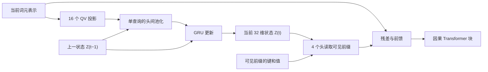

# Stargazer Aleph 的递归查询状态与多步关系组合

## 摘要

我们研究小型因果序列模型如何在一张新事实图上计算多步关系查询。Stargazer 将逐词元投影、递归状态更新和前缀键值读取分配给不同模块。每个前缀更新一个 32 维状态 $Z_t$，用它构造读取查询。我们在八节点合成图上训练两种 Aleph 原型，并以 $G(F^4(x))$ 作为 Chain5 任务。旧版有 155,584 个推理参数，新版在同一底座前增加情景查询层后有 175,682 个参数。两版均用原始 64 词元题面通过单次独立验收。旧版常规题和严格题的准确率为 90.82% 和 96.68%，新版为 90.23% 和 98.73%。

在较早的 248,000 步检查点，我们用同一批独立题比较了单次前向和三次前向。三次前向用训练得到的线性读出连续预测两次 $F^2$，再用预测终点查询 $G$。旧版常规题从 61.87% 升至 95.12%，新版从 61.52% 升至 98.00%。严格题也出现同方向变化。单次与三次结果支持将**部件可读出性**和**单次组合成功率**分别测量。本文的架构对照来自较浅的 Chain3 实验，Chain5 结果每版各来自一条训练谱系。

**关键词**　递归注意力、因果序列模型、关系组合、课程学习、合成图

## 1 引言

从同一组事实中找出 $G(x)$，与根据问题选择一条关系路径再找出 $G(F^4(x))$，对模型提出不同要求。即使事实读取已经接近满分，模型仍可能在运算次序变更时沿用原来的答案。因此我们将事实表保持固定，只改变同一张图上的查询深度，并分别记录每种深度以及同图各问全对的比例。

早期实验说明了这一设计的必要性。简单的检索任务允许忽略问题、输出输入中最常见的值，查询无关基线达到 25.37%。在后来的 Chain1/2 对照中，五个已掌握基础查询的实例继续混合训练 20,000 步，最终仍有 0/5 通过联合验收。严格题上同图两问的答案必须不同，模型开始给出不同答案之后，Chain2 的正确率仍接近从八个候选值中猜测的 12.5%。这些结果促使我们采用中间节点监督、逐步撤提示和独立的事实图验收。[任务诊断](../TASK_DIAGNOSIS.md) · [Chain2 混合训练记录](../CHAIN2_FINDINGS.md)

本文关注两个实证问题。第一，递归 Stargazer 能否在无中间提示的题面上完成 $G(F^4(x))$。第二，当单次准确率还低时，模型内部已经可读出的中间结果能否支持显式组合。后一问题采用同一检查点、同一批题的配对试验。

## 2 相关工作

标准 Transformer 使用因果自注意力在可见词元间读取信息。Sanford 等给出了自注意力与大规模并行计算之间的理论联系。Peng 等研究了在特定模型和规模条件下单层 Transformer 对函数复合的限制。这些理论结果为研究计算深度提供背景。本实验的八节点规模、两块网络和额外递归状态对应另一个设置。[Vaswani 等，2017](https://proceedings.neurips.cc/paper_files/paper/2017/hash/3f5ee243547dee91fbd053c1c4a845aa-Abstract.html) · [Sanford 等，2024](https://proceedings.mlr.press/v235/sanford24a.html) · [Peng 等，2024](https://arxiv.org/abs/2402.08164)

GRU 为固定宽度序列状态提供门控更新。Recurrent Memory Transformer 则依靠记忆词元在输入分段之间传递状态。本文的递归状态在每个词元更新，直接提供因果注意力的查询。分步推理方面，Nye 等研究了显式中间计算，Khona 等在合成图导航中比较了直接推理与分步推理。这里的三次前向由宿主定义函数调用顺序，中间节点由模型预测。[Cho 等，2014](https://arxiv.org/abs/1406.1078) · [Bulatov 等，2022](https://arxiv.org/abs/2207.06881) · [Nye 等，2021](https://arxiv.org/abs/2112.00114) · [Khona 等，2024](https://arxiv.org/abs/2402.07757)

## 3 模型

### 3.1 递归 Stargazer

设序列中的第 $t$ 个隐藏向量为 $x_t$，宽度为 64。第一块为递归 Stargazer，第二块为标准因果 Transformer。两块使用前置层归一化、残差和 GELU 前馈网络。最终模型将第一块的前馈宽度从 256 拓到 512。旧通道保持原值，新通道的输出矩阵从零开始，使拓宽初始化保留原模型的输出。

**QV 投影。** 将归一化输入 $u_t=\mathrm{LN}(x_t)$ 一次投影成 16 个四维向量 $s_{t,h}$。这些投影可并行计算。它们的输出只依赖当前输入，在这个模块中没有词元间的成对打分。较早的非递归原型曾用前缀均值，本文的递归版通过传递上一时刻的状态携带历史。

**QK 池化与状态更新。** 所有微型头共享仿射键映射 $K$ 和值映射 $V$。单个学习查询 $q_0$ 与上一状态共同决定各头的权重。$Z_0=0$，每次更新覆盖上一状态。

$$
q_t=q_0+W_pZ_{t-1},\qquad
\alpha_{t,h}=\operatorname{softmax}_{h}
\left(\frac{q_t^\top K(s_{t,h})}{\sqrt{64}}\right),\qquad
Z_t=\mathrm{GRUCell}\!\left(\sum_h\alpha_{t,h}V(s_{t,h}),Z_{t-1}\right).
$$

**KV 读取。** 从 $Z_t\in\mathbb{R}^{32}$ 投影出四个 16 维查询。每个头对 $i\le t$ 的输入键值做缩放点积注意力。各头输出拼接投影后加入第一块的输入残差，再经该块前馈网络和第二个 Transformer 块。项目中把这条固定宽度的查询接口称为全局结论瓶颈。它约束状态接口的维数。原始因果键值和残差各自保留可用信息。



**图 1　递归 Stargazer 底座。** 图中只画出第一块的查询生成与读取，以及到第二块的连接。

逐词元状态更新存在时间依赖。四个读取头及线性投影可做张量并行。固定宽度的 $Z_t$ 只需保留最新副本，增量推理的键值缓存仍随长度 $T$ 增长。隐藏宽度为 $d$ 时，两块的密集因果注意力仍包含 $O(T^2d)$ 的计算项。本文的测量涉及任务准确率，硬件异构吞吐和长序列效率仍无对照数据。[递归实现](../recursive_stargazer.py) · [模型与增量推理](../stargazer.py) · [拓宽验证](../conversation_memory/training/v0.001Aleph-chain5-wide512-20k/REPORT.md)

### 3.2 前置情景查询层

新版在上述两块前加入 20,098 个参数。前置层有 32 个二维查询头，从固定的七条情景戳向量中读取。查询由当前词元和先前状态生成。状态 $Z_{1,t}$ 的五维编码当前词元，其余 27 维通过 GRU 总结先前状态和本次读取。前置层解码这两部分后加入位置编码，交给递归底座。每个题面开始时两类递归状态从零初始化。

Chain5 中情景戳作为固定输入快照。题目的 $F$ 与 $G$ 事实来自当题的 64 词元序列。单独的 Chain4 接入小测中，开关情景读取两组得分均为 97/100 和 99/100，有两道严格题的预测改变。这个小测提供了接入和因果性检查，真实情景检索对 Chain5 分数的独立贡献仍待分离。[前置层实现](../conversation_memory/aleph_episode_front.py) · [Chain4 接入小测](../conversation_memory/evaluations/v0.001Aleph-chain4-episodic-z1-prefix/REPORT.md)

## 4 任务与实验

### 4.1 关系图与独立划分

节点集合 $V=\{1,\dots,8\}$。关系 $F:V\to V$ 是排列，$G:V\to\{16,\dots,31\}$ 将节点映射到答案词元。Chain $k$ 的目标为 $G(F^{k-1}(x))$，$F^0(x)=x$。每题的输入由随机打乱的 16 条关系三元组、8 个干扰词元、一个分隔词元、5 个操作槽、一个 $G$ 操作词元和起点 $x$ 组成，共 64 个词元。以 Chain5 为例，五个操作槽中有四个 $F$，最终作答读取末位置的词表分数。训练辅助标签和教师提示不出现在单次验收输入中。

常规题中，$F$ 混合单个八节点环与任意随机排列，$G$ 混合无放回与有放回抽样。严格题要求单个八节点环及八个互不相同的 $G$ 值。同张严格图从同一起点问 Chain1 至 Chain5 时，五个标准答案互不相同。严格约束针对不同深度得到同一个答案的捷径。同时，重复值歧义主要出现在常规组，所以两组的实测难度需要分别报告。

例如，同一个起点为 1 的题面包含路径 $1\to 3\to 7\to 2\to 6$，其中 $G(1)=16$，$G(6)=29$。Chain1 的答案是 16，Chain5 的答案是 29。输入提供的是打乱的关系三元组，箭头串只在这里用于说明标准解法。

每个测试图以按节点排序的整张 $F/G$ 映射为隔离单位，忽略三元组顺序、起点和询问深度。生成测试时排除归档的训练映射、开发映射与此前验收映射。独立参考解题器重算标签。同图问多种深度时，同一张图上的多个答案具有相关性。主结果按深度分别报告，Chain5 每场包含常规 2,048 图、严格 1,024 图。[数据生成](../logic_v1/tasks.py) · [独立参考解题器](../logic_v1/verify.py) · [验收工具](../conversation_memory/aleph_chain5.py)

### 4.2 课程与验收

Chain3 和 Chain4 阶段采用从辅助提示到无提示的教育式训练，并回顾较短的查询。Chain5 两版分别从各自的 Chain4 谱系开始，先在同一题序上完成 20,000 步拓宽训练，再继续课程。本文最后一轮从两版各自的 Chain5 第 192,000 步完整 AdamW 状态接续。单次达标时，旧版在本轮新增 720,000 次更新，新版新增 604,000 次更新。步数为本任务的累计优化器更新数，先前任务的更新另计。

课程以答案交叉熵为主。根据阶段，训练还采用 $F^2$ 与 $F^4$ 等中间节点监督、注意力读取位置监督和短查询教师的分布监督。后段增加无提示批次、只改目标值或干扰值的成对练习以及按错误回练。训练批次从 32 逐步扩到 54 和 76，学习率按归档日程调整。主轮每 500 步保存权重、辅助读出、优化器和开发分数。这里的阶段是探索性改动，各组件未在同一固定预算实验中独立随机化。单次验收以两个独立题组各达到 90% 为判据，并保存通过验收的检查点均值。

三次前向实验独立选取较早的检查点。对旧版在 236,000 和 248,000 步、新版在 232,000 和 248,000 步分别做开发集筛选，按两组中较低的准确率选择，两版均选中 248,000 步的原始权重。输入相同事实表，第一遍用原始 Chain5 题面，第二遍仅更换起点，第三遍把问题改成 Chain1。前两遍从第一块的末位置读出 $F^2$，使用同一个 $8\times64+8=520$ 参数线性头，该读出用训练标签学习。每遍重新计算题面前缀，宿主依次代入模型的预测。真实中间节点只用于事后评分。首遍原生输出同时给出同权重的单次分数。

$$
\hat u=\widehat{F^2}(x),\qquad \hat v=\widehat{F^2}(\hat u),
\qquad \hat y=\widehat G(\hat v).
$$

[课程与环境记录](../conversation_memory/training/v0.001Aleph-chain5-wide-mastery90/curriculum.json) · [训练实现](../conversation_memory/aleph_chain5_mastery.py) · [三次调用实现](../conversation_memory/aleph_chain5_three_pass.py)

## 5 结果

### 5.1 单次无提示 Chain5

**表 1　两版达到单次门槛时的独立验收**

| 模型 | 推理参数 | Chain5 步数 | 平均窗口 | 常规题 | 严格题 |
|:--|--:|--:|--:|--:|--:|
| 旧版 Aleph | 155,584 | 912,000 | 20 | 1,860/2,048（90.82%） | 990/1,024（96.68%） |
| 新版 Aleph | 175,682 | 796,000 | 5 | 1,848/2,048（90.23%） | 1,011/1,024（98.73%） |

表 1 的两版各在自己的独立题组通过 90% 验收。新版在开发集筛选后通过，此前七次根据同一筛选规则启动的独立验收均未通过常规门槛，附录列出各次结果。旧版预先指定 912,000 步及 20 检查点窗口做固定节点复测。该快照的常规开发题为 452/512（88.28%），独立分数为 90.82%。这些是各自通过的记录，准确率受测试抽样、检查点选择和训练路径影响。

两版在 720,000 步时用同一批独立图及相同的 20 检查点平均窗口做过配对比较。常规题旧版为 1,782/2,048（87.01%），新版为 1,818/2,048（88.77%）。常规题中仅新版答对 183 道，仅旧版答对 147 道。严格题旧版为 978/1,024（95.51%），新版为 1,003/1,024（97.95%）。严格题中仅新版答对 42 道，仅旧版答对 17 道。这组差异来自两条已训练谱系，新增层、参数量和先前初始化均有差异。

在两版 Chain5 验收快照上，还用各自的事实图追问 Chain1 至 Chain4。旧版的常规 Chain4 为 1,793/2,048（87.55%），新版为 1,781/2,048（86.96%）。同图五问全对的常规成绩分别为 1,616/2,048（78.91%）和 1,608/2,048（78.52%）。此前 Chain4 独立验收的常规成绩为 96.34%，当时另用一批新图。当前结果提示需要同时报告低深度任务的保持表现。

[单次验收总记录](../conversation_memory/training/v0.001Aleph-chain5-wide-mastery90/CHAIN5_90_REPORT.zh.md) · [720,000 步同题复测](../conversation_memory/training/v0.001Aleph-chain5-wide-mastery90/confirm-single-02/REPORT.zh.md)

探索性分层也观察到了重复值与错误的关系。在 465,000 步同一组常规开发图上，将 512 题按 $G$ 是否有重复值划分。旧版分别答对 167/221 道重复值题和 254/291 道无重复值题。新版分别答对 163/221 道和 270/291 道。这个比较保留了实际题组的其他差异，属于错误诊断。

### 5.2 同权重单次与三次前向

**表 2　248,000 步的同题配对结果**

| 模型 | 题组 | 单次答对 | 三次答对 | 净变化 | 仅三次答对 | 仅单次答对 |
|:--|:--|--:|--:|--:|--:|--:|
| 旧版 | 常规 | 1,267/2,048（61.87%） | 1,948/2,048（95.12%） | +33.25 个百分点 | 724 | 43 |
| 旧版 | 严格 | 694/1,024（67.77%） | 982/1,024（95.90%） | +28.13 个百分点 | 313 | 25 |
| 新版 | 常规 | 1,260/2,048（61.52%） | 2,007/2,048（98.00%） | +36.47 个百分点 | 762 | 15 |
| 新版 | 严格 | 700/1,024（68.36%） | 1,006/1,024（98.24%） | +29.88 个百分点 | 312 | 6 |

每行使用同一模型权重和同一批题。三次方案同时增加了两次模型调用、启用中间读出并采用规定的组合次序，表中差值反映整个推理方案的改变。把最后一遍针对模型自报终点的 $G$ 预测与该终点的真实 $G$ 值比较，旧版正确 3,071/3,072，新版正确 3,070/3,072。严格题上，两版实际得到正确 $F^4(x)$ 节点的次数分别为 983/1,024 和 1,007/1,024。严格题的 $G$ 取值互异，每个输出值至多对应一个终点。[三次推理记录及逐题数据](../conversation_memory/training/v0.001Aleph-chain5-wide-mastery90/confirm-three-pass/REPORT.zh.md)

### 5.3 较浅任务的 Transformer 对照

Chain3 同题对照使用一对种子 1 的模型。两边各从本任务 38,000 步开始同步续训 73,100 步，使用相同的新训练题、课程和 25 检查点平均窗口。递归 Aleph 有 122,560 个推理参数，标准 Transformer 有 108,288 个。两边进场时已有不同的 Chain2 能力。

**表 3　相同续训课程的 Chain3 对照**

| 模型 | 常规 Chain3 | 严格 Chain3 |
|:--|--:|--:|
| 递归 Aleph | 1,949/2,048（95.17%） | 991/1,024（96.78%） |
| Transformer | 503/2,048（24.56%） | 155/1,024（15.14%） |

旧版递归底座随后完成 Chain4，常规为 1,973/2,048（96.34%），严格为 1,014/1,024（99.02%）。这两组结果记录了课程推进中的可行性，架构因果比较需要控制起始能力、参数规模和调参预算。较早的三个配对种子查询训练中，两种架构都各有一个实例到 100,000 步仍未达到联合查询门槛。种子 0 和种子 2 的相对结果方向不同，应同时纳入对训练稳定性的解释。

[Chain3 同题对照](../conversation_memory/training/v0.001Aleph-chain3-mastery/confirm-111100/报告.md) · [Chain4 记录](../conversation_memory/training/v0.001Aleph-chain4-education/confirm-612000/CHAIN4_EDUCATION.md) · [三个配对种子](../LEARNING_DURATION_FINDINGS.md)

## 6 讨论与局限

**显式组合与原生组合。** 同一快照的配对结果显示，第一块的状态可读出有用的 $F^2$ 信息。把预测交给下一次调用后，模型能在该分布上完成大部分 Chain5 查询。单次训练继续到较晚检查点后也达到验收门槛。两个结果共同区分了一个中间量能否被读出，以及原始前向能否在一次调用内用它完成任务。读出结果本身对内部因果机制的证明力有限。

**抽样、停止与外推。** 各独立验收使用新事实图，报告每次尝试及检查点选择。通过门槛是样本结果。重复测试、开发集择优和两版不同的停止规则会影响简单的跨版本比较。Chain5 只有一条训练谱系对应每个版本，尚缺同预算、同初始化任务能力和参数匹配的 Transformer 对照。当前所有图使用八节点与固定词表，实验覆盖同分布新映射，跨词表、跨图规模、跨深度外推还需独立测量。

**记忆和硬件归因。** 新版同时改变了模型容量、前置递归与情景读取。Chain5 再训练了整个模型，固定情景戳和额外层的贡献有待独立消融。早期非递归版的动态 $Z$ 对照中，动态和学习常量 $Z$ 的 4096 题准确率差值为 −0.19 个百分点，种子配对重采样区间跨零。该结果为动态状态假设提供了需要保留的负结果。当前训练和验收使用 GPU，实现仍含密集注意力。CPU/GPU 分工与 0.1B 参数规模是下一阶段待测问题。[早期状态消融](../Z_CONTROL_RESULTS.md)

## 7 结论

递归 Stargazer 的两个小型原型在独立八节点事实图上通过了无提示单次 Chain5 验收。更早的快照已经可借助一个受监督的中间读出和三次调用获得较高准确率。同题、同权重的配对结果提供了可复核的依据，说明在这个设置下，原生单次完成查询所需的训练与显式调用模型部件的能力可以分别追踪。

## 参考文献

1. Vaswani, A., Shazeer, N., Parmar, N., et al. (2017). [Attention Is All You Need](https://proceedings.neurips.cc/paper_files/paper/2017/hash/3f5ee243547dee91fbd053c1c4a845aa-Abstract.html). *Advances in Neural Information Processing Systems*, 30.
2. Sanford, C., Hsu, D., & Telgarsky, M. (2024). [Transformers, parallel computation, and logarithmic depth](https://proceedings.mlr.press/v235/sanford24a.html). *Proceedings of Machine Learning Research*, 235, 43276–43327.
3. Peng, B., Narayanan, S., & Papadimitriou, C. (2024). [On Limitations of the Transformer Architecture](https://arxiv.org/abs/2402.08164). arXiv:2402.08164.
4. Cho, K., van Merriënboer, B., Gülçehre, Ç., et al. (2014). [Learning Phrase Representations using RNN Encoder-Decoder for Statistical Machine Translation](https://arxiv.org/abs/1406.1078). EMNLP.
5. Bulatov, A., Kuratov, Y., & Burtsev, M. S. (2022). [Recurrent Memory Transformer](https://arxiv.org/abs/2207.06881). NeurIPS.
6. Nye, M., Andreassen, A. J., Gur-Ari, G., et al. (2021). [Show Your Work: Scratchpads for Intermediate Computation with Language Models](https://arxiv.org/abs/2112.00114). arXiv:2112.00114.
7. Khona, M., Okawa, M., Hula, J., et al. (2024). [Towards an Understanding of Stepwise Inference in Transformers: A Synthetic Graph Navigation Model](https://arxiv.org/abs/2402.07757). arXiv:2402.07757.

## 附录 A 新版单次筛选后的独立验收

每行使用一批新的独立事实图。两次固定节点共用题复测见前述验收记录。

| 累计步数 | 平均窗口 | 常规正确数 / 2,048 | 严格正确数 / 1,024 |
|--:|--:|--:|--:|
| 640,000 | 20 | 1,793 | 992 |
| 783,000 | 5 | 1,817 | 1,006 |
| 786,000 | 5 | 1,828 | 1,000 |
| 788,000 | 20 | 1,826 | 1,007 |
| 790,000 | 20 | 1,836 | 1,013 |
| 792,000 | 20 | 1,837 | 1,001 |
| 794,000 | 5 | 1,841 | 1,004 |
| 796,000 | 5 | 1,848 | 1,011 |

## 附录 B 存档与复现

验收目录包括题面、标准答案、逐题预测、冻结权重的 SHA-256、原始训练检查点与完整 AdamW 状态。归档工作已用保存的权重重算单次和三次预测，并复核标签与事实映射互斥。环境为 Windows、Python 3.15、RTX 5090 Laptop 24 GB，主要记录使用 PyTorch FP32 并关闭 TF32。跨软件和硬件版本应重新核对数值。

在 Project Stargazer 根目录用 PowerShell 复算已归档的两项验收。

```powershell
$run = 'conversation_memory/training/v0.001Aleph-chain5-wide-mastery90'
python -m conversation_memory.aleph_chain5_three_pass --run $run
python -m conversation_memory.aleph_chain5_confirm_single --run $run --trial 3 --old 912000 20
```

新版单次的验收权重、题、预测及散列见 [796,000 步归档](../conversation_memory/training/v0.001Aleph-chain5-wide-mastery90/confirm-796000/REPORT.zh.md)。整体文件索引见 [Chain5 验收存档](../conversation_memory/training/v0.001Aleph-chain5-wide-mastery90/CHAIN5_90_REPORT.zh.md)。
